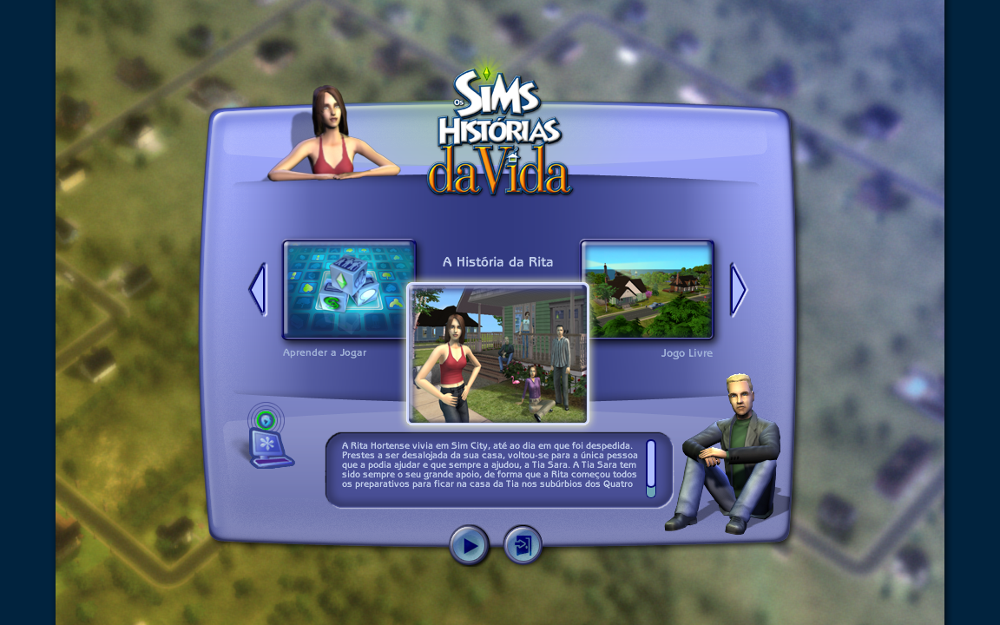

# The Sims Life Stories PT — Mac OS X

Iniciador para abrir o **The Sims Life Stories** em português no Mac OS X. O
aplicativo é separado, não substitui o jogo original e não altera arquivos do
sistema.

> Compatibilidade validada experimentalmente em um MacBook2,1 com Mac OS X Lion
> 10.7. O resultado depende dos recursos de idioma presentes na instalação do
> jogo.

## Como usar

1. Baixe este repositório pelo botão **Code > Download ZIP**.
2. Extraia o ZIP.
3. Dentro da pasta extraída, localize **The Sims Life Stories PT.app** e
   arraste-o para a Mesa ou para Aplicativos.
4. Dê dois cliques no aplicativo.

O iniciador procura o jogo nos locais mais comuns. Se não encontrar, abre uma
janela para você selecionar o **The Sims Life Stories.app**. Essa escolha fica
salva para as próximas execuções.

O aplicativo pode ficar em qualquer lugar. O jogo pode estar em outro local,
desde que seja selecionado na primeira execução.

## O que ele faz

- abre o executável real do `The Sims Life Stories.app` com `-l:Portuguese`;
- mantém o jogo original intacto;
- não instala arquivos no sistema;
- não inclui arquivos do jogo;
- funciona com instalações que já contenham os recursos de idioma em português.

Se a instalação não tiver os recursos portugueses, o iniciador não consegue
criar a tradução sozinho e o jogo pode continuar em inglês.

O iniciador também não remove a exigência de mídia do jogo. Se o Life Stories
pedir o disco, é necessário inserir a mídia correspondente ou usar uma
instalação que já funcione sem essa exigência; o iniciador não modifica o
executável original.

## Demonstração

Captura do jogo em português:



## Uso manual pelo Terminal

Quem preferir iniciar manualmente pode usar:

```sh
open "/Applications/The Sims Life Stories.localized/The Sims Life Stories.app" --args "-l:Portuguese"
```

Para outra localização, substitua o caminho pelo local correto do jogo.

## Instalação opcional pelo Terminal

O repositório também mantém um instalador para copiar somente o aplicativo
para a Mesa:

```sh
sh macos/install.sh
```

Por padrão, o destino é:

```text
~/Desktop/The Sims Life Stories PT.app
```

## Como desfazer

Apague apenas **The Sims Life Stories PT.app**. O jogo original não é
modificado.

## Observações

Este projeto contém apenas o iniciador, o ícone e a documentação. Cada usuário
deve fornecer sua própria cópia do jogo e seus próprios recursos de idioma. O
projeto não promete compatibilidade universal com todas as edições.
